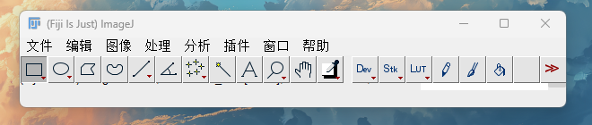

# Fiji Chinese Localization

A runtime Chinese localization plugin for [Fiji](https://fiji.sc/) (the ImageJ distribution).

Fiji/ImageJ has **no i18n resource mechanism** — UI strings are hardcoded in Java bytecode.
Instead of patching jars, this plugin walks the menus at startup and replaces the labels.
Nothing is modified on disk, so it is fully reversible and does not break macros or shortcuts.



## Features

- Main menu bar: 文件 / 编辑 / 图像 / 处理 / 分析 / 插件 / 窗口 / 帮助
- Every submenu at any depth (recursive): e.g. 图像 → 变换 → 水平翻转 / Z 轴翻转 …
- ImageJ2 legacy duplicate menu bar: unique commands are merged, the duplicated bar is removed
- Swing menu bars (`JRootPane` and component-tree embedded), duplicates hidden
- Right-click popup menus in image windows

Measured on Fiji 2.16.0 / ImageJ 1.54p:

```
awt=1067  swing=2  hidden=0  dedupe=7  missing=189  dict=917
```

Original English labels are kept as `actionCommand`, so `run("Analyze Particles...")`,
keyboard shortcuts and scripts keep working.

## Install

Copy three files into the Fiji installation:

```
Fiji.app/
├── plugins/Zh_Locale.jar
├── plugins/zh_dict.txt
└── macros/AutoRun/ChineseLocalization.ijm
```

Restart Fiji. Menus turn Chinese within a few seconds.

## Build

```powershell
.\build.ps1                        # Windows, uses JDK bundled with ..\Fiji.app
FIJI_HOME=/Applications/Fiji.app ./build.sh   # macOS / Linux
```

Output goes to `dist/`, mirroring the Fiji directory layout.

## Extend the dictionary

`plugins/zh_dict.txt`, one entry per line, `English<TAB>Chinese`:

```text
Open...	打开...
```

Restart Fiji to apply — no recompilation needed. `plugins/zh_missing.txt`
lists every menu item that is still untranslated.

## Limitations

- Plugin dialogs, buttons and messages are generated at runtime and stay English.
- Proper nouns (TrackMate, TrakEM2, file format names, sample image names) stay English on purpose.
- Fiji Updater may warn that `Zh_Locale.jar` is not in its checksum database — harmless.

## How it works

1. `macros/AutoRun/ChineseLocalization.ijm` runs `run("Zh Locale")` on startup.
2. The plugin collects menus from four sources: `Menus.getMenuBar()`,
   every `Frame.getMenuBar()`, `JRootPane.getJMenuBar()`, and any `JMenuBar`
   found in the component tree.
3. Labels are replaced from the dictionary; the original label is stored as `actionCommand`.
4. ImageJ2 legacy appends a duplicate set of menus — unique items are merged, then the
   duplicates are removed.
5. A background thread re-scans every 5 s for two minutes, because the Swing (ImageJ2)
   menu bar is created asynchronously after startup.

See [docs/technical-notes.md](docs/technical-notes.md) for the reverse-engineering notes.

## License

[MIT](LICENSE). Not affiliated with the Fiji, ImageJ or SciJava projects.
