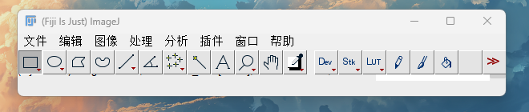

# Fiji 中文汉化插件 · Fiji Chinese Localization

给 [Fiji](https://fiji.sc/)（ImageJ 发行版）加上中文菜单的运行时汉化插件。

Fiji/ImageJ 没有多语言资源机制（界面字符串硬编码在 Java 字节码里），因此本项目不改动任何原始 jar，
而是在启动后遍历菜单并替换文字——**随时可卸载、可逆、不影响宏和快捷键**。



## 功能

| 覆盖范围 | 说明 |
|---|---|
| 主菜单栏 | 文件 / 编辑 / 图像 / 处理 / 分析 / 插件 / 窗口 / 帮助 |
| 所有层级子菜单 | 递归遍历，无限深度（如 图像 → 变换 → 水平翻转 / Z 轴翻转 …） |
| ImageJ2 legacy 菜单 | 自动识别重复菜单，把独有命令合并后删除重复菜单栏，菜单恢复成 8 项 |
| Swing 菜单栏 | 兼容 `JRootPane` 挂载与组件树内嵌两种方式，重复的会隐藏 |
| 右键弹出菜单 | 图像窗口右键菜单 |

实测统计（Fiji 2.16.0 / ImageJ 1.54p）：

```
awt=1067  swing=2  hidden=0  dedupe=7  missing=189  dict=917
```

- `awt`：已汉化的 AWT 菜单项数量
- `dedupe`：合并掉的重复菜单栏数量
- `dict`：词典条目数
- `missing`：未翻译条目数（绝大多数是示例图像名、LUT 文件名、文件格式名和插件专有名词，保留英文更合适）

关键设计：翻译时把原始英文标签写回 `actionCommand`，所以 `run("Analyze Particles...")` 之类的
宏调用、快捷键、脚本都不受影响。

## 安装

### 方式一：直接复制文件（推荐）

把下面 3 个文件复制进 Fiji 安装目录：

```
Fiji.app/
├── plugins/Zh_Locale.jar                    # 汉化插件
├── plugins/zh_dict.txt                      # 扩展词典（可编辑）
└── macros/AutoRun/ChineseLocalization.ijm   # 启动时自动执行 run("Zh Locale")
```

重启 Fiji 即可。菜单栏在启动 3~5 秒内变成中文（右侧 ImageJ2 菜单栏稍晚，由后台线程补扫）。

### 方式二：自行构建

```powershell
# Windows（使用 Fiji 自带的 JDK）
.\build.ps1                          # 默认读取 ..\Fiji.app
.\build.ps1 -FijiHome D:\Fiji.app    # 指定其他 Fiji 目录

# macOS / Linux
FIJI_HOME=/Applications/Fiji.app ./build.sh
```

构建产物在 `dist/`，目录结构与 Fiji 安装目录一致，直接覆盖复制即可。

## 卸载 / 恢复英文

删除这 3 个文件即可，原始 jar 一个都没有被修改：

```
Fiji.app/plugins/Zh_Locale.jar
Fiji.app/plugins/zh_dict.txt
Fiji.app/macros/AutoRun/ChineseLocalization.ijm
```

## 扩充词典

`plugins/zh_dict.txt`，每行 `英文<TAB>中文`，`#` 开头为注释，保存后重启 Fiji 生效，**无需重新编译**。

```text
Open...	打开...
Gaussian Blur...	高斯模糊...
```

不知道缺哪些？看插件生成的 `plugins/zh_missing.txt`——它就是当前仍未翻译的菜单项清单，照单补即可。

## 诊断文件

插件会在 `Fiji.app/plugins/` 下生成三个小文件，便于排查和贡献：

| 文件 | 内容 |
|---|---|
| `zh_report.txt` | 上次汉化统计（awt/swing/hidden/dedupe/missing/dict） |
| `zh_missing.txt` | 尚未翻译的菜单项清单 |
| `zh_frames.txt` | 窗口与菜单栏结构快照 |

## 已知限制

- **插件对话框不汉化**：各命令的对话框文字在运行时动态生成，无法统一拦截，仍是英文。
- **专有名词保留英文**：TrackMate、TrakEM2、BigDataViewer、Bio-Formats 等插件名，以及样本图像名、LUT 名、文件格式名。
- **Fiji 更新器提示**：`Zh_Locale.jar` 不在官方校验库中，更新器可能提示"未校验"，属正常现象，忽略即可。
- **Windows 防火墙**：首次启动 Java 会弹网络访问询问，点"允许"即可，不影响汉化。
- 只在 Windows + Fiji 2.16.0 实测；macOS/Linux 理论上可用（AutoRun 宏机制相同），欢迎反馈。

## 工作原理（简述）

1. `macros/AutoRun/ChineseLocalization.ijm` 在启动时执行 `run("Zh Locale")`；
2. 插件遍历四处菜单源：`Menus.getMenuBar()`、所有 `Frame.getMenuBar()`、`JRootPane.getJMenuBar()`、组件树里的 `JMenuBar`；
3. 按词典替换标签，同时保留原始 `actionCommand`；
4. 合并 ImageJ2 legacy 追加的重复菜单，删除重复项；
5. 后台线程每 5 秒补扫 2 分钟，捕捉启动后才异步创建的菜单。

更详细的逆向记录见 [docs/technical-notes.md](docs/technical-notes.md)。

## 项目结构

```
fiji-zh-locale/
├── src/Zh_Locale.java          # 插件源码（默认包，ImageJ1 插件扫描要求）
├── dict/zh_dict.txt            # 917 条词典
├── macros/ChineseLocalization.ijm
├── build.ps1 / build.sh        # 构建脚本
├── docs/
│   ├── usage-zh.md             # 中文使用说明
│   ├── technical-notes.md      # 技术记录（菜单源、重复菜单、打包坑）
│   └── screenshots/
└── .github/workflows/build.yml # CI：编译 + 打 jar
```

## 致谢与声明

- 本项目只修改运行时界面文字，不修改 Fiji/ImageJ 本身，与 Fiji、ImageJ、SciJava 项目无隶属关系。
- Fiji 及相关库版权归各自作者所有，遵循各自许可证。

## License

[MIT](LICENSE)
